# AVES — Avian & Exotic Animal Veterinary Services Jakarta

<p align="center">
  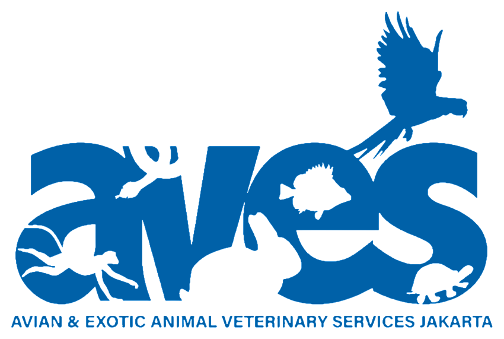
</p>

<h3 align="center">
  Sistem Pakar Diagnosis Awal Penyakit Kulit Burung
</h3>

<p align="center">
  Aplikasi berbasis web untuk membantu proses screening awal penyakit kulit
  pada burung menggunakan metode Certainty Factor.
</p>

<p align="center">
  <a href="#tentang-proyek">Tentang Proyek</a> •
  <a href="#fitur-utama">Fitur</a> •
  <a href="#teknologi">Teknologi</a> •
  <a href="#instalasi">Instalasi</a> •
  <a href="#dokumentasi-tampilan">Dokumentasi</a>
</p>

## Dokumentasi Tampilan

### Halaman Beranda

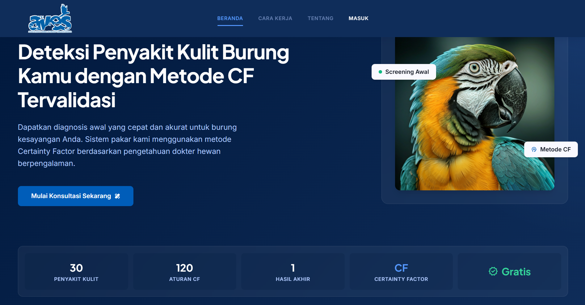

Halaman beranda menampilkan informasi utama mengenai aplikasi AVES.

### Halaman Login

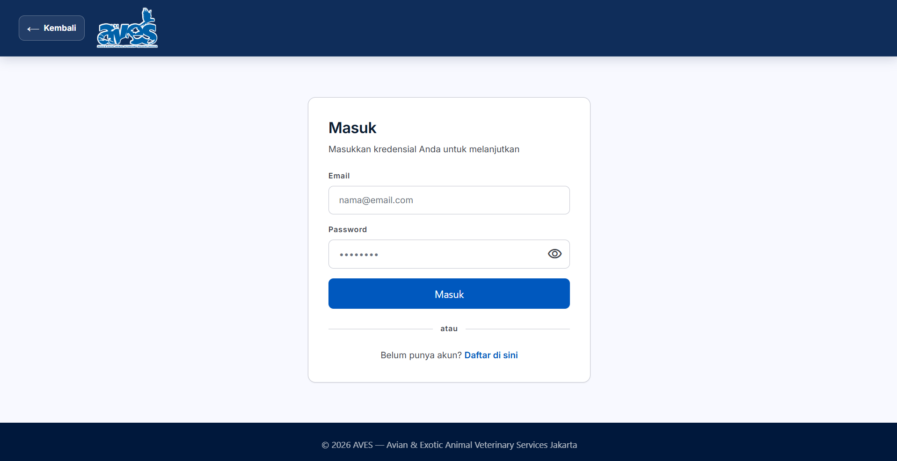

Halaman login digunakan untuk masuk sebagai pengguna atau administrator.

### Halaman Konsultasi

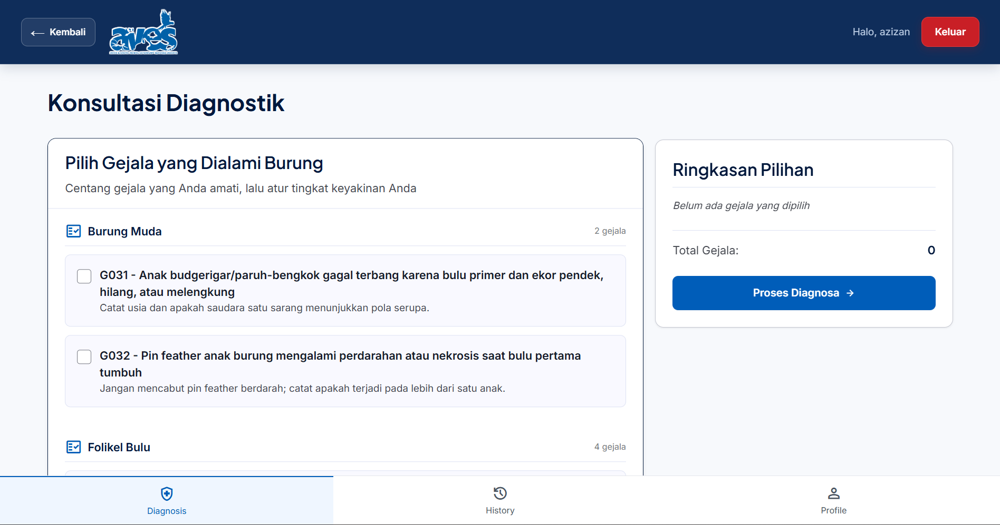

Halaman konsultasi digunakan untuk memilih gejala penyakit burung.

### Pemilihan Gejala

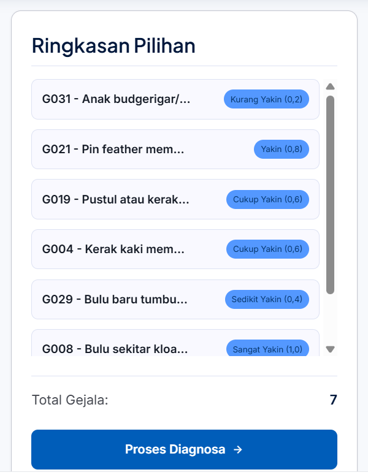

Pengguna dapat memilih gejala dan menentukan tingkat keyakinan.

### Hasil Diagnosis

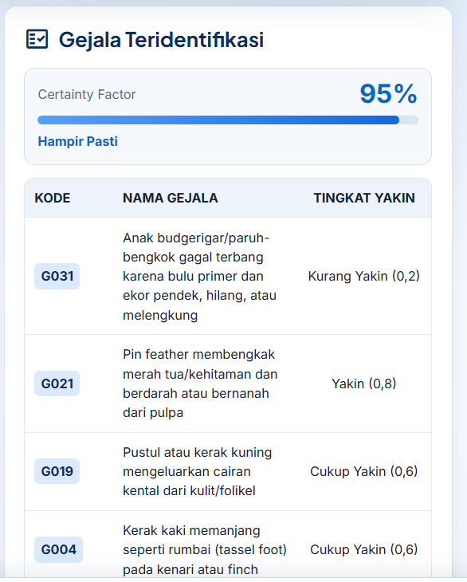

Sistem menampilkan kemungkinan penyakit dan nilai Certainty Factor.

### Detail Penyakit

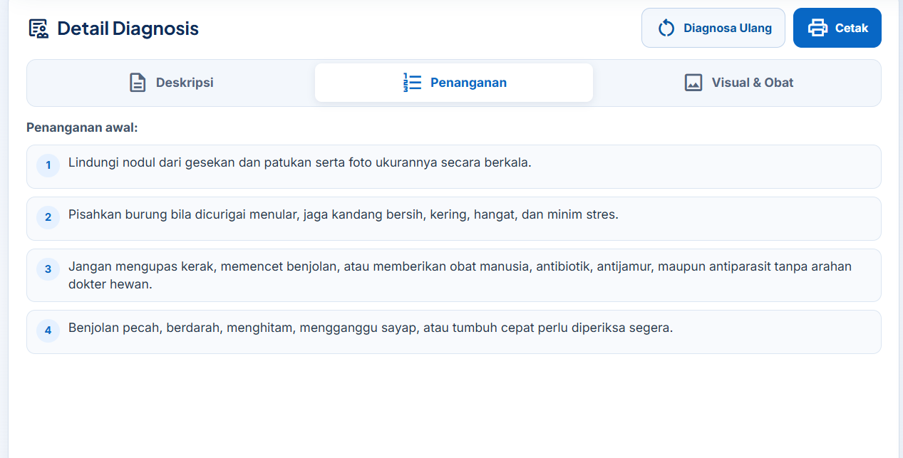

Halaman ini menampilkan deskripsi penyakit dan saran penanganan.

### Riwayat Diagnosis

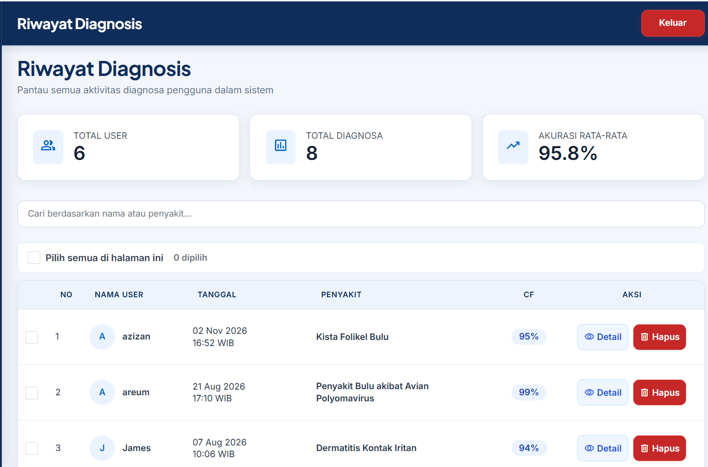

Pengguna dapat melihat riwayat konsultasi yang pernah dilakukan.

### Dashboard Administrator

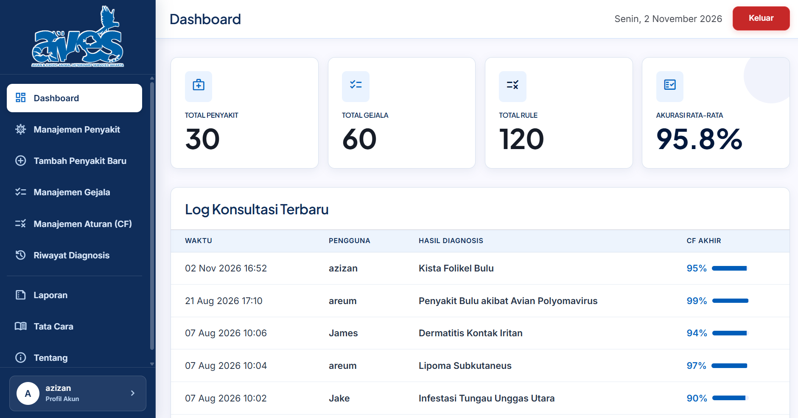

Administrator dapat memantau data dan aktivitas sistem.

### Manajemen Basis Pengetahuan

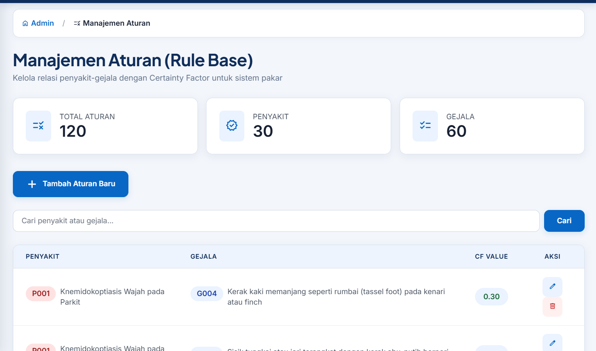

Administrator dapat mengelola penyakit, gejala, dan aturan Certainty Factor.

### Laporan PDF

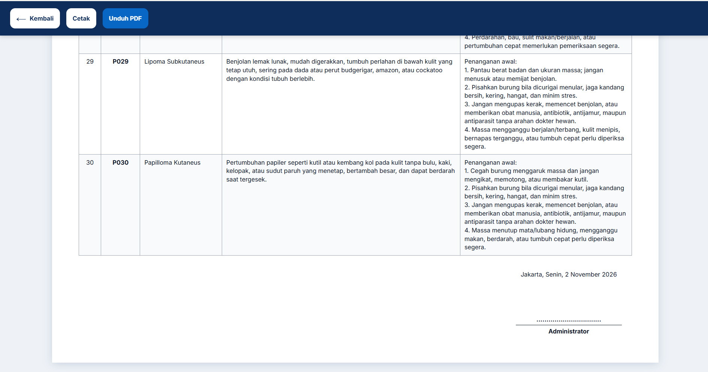

Sistem dapat membuat laporan data dalam format PDF.
---

## Tentang Proyek

AVES atau **Avian & Exotic Animal Veterinary Services Jakarta** merupakan
aplikasi sistem pakar yang dikembangkan untuk membantu pengguna melakukan
screening awal terhadap penyakit kulit pada burung.

Pengguna dapat memilih gejala yang dialami burung beserta tingkat keyakinannya.
Sistem kemudian melakukan perhitungan menggunakan metode **Certainty Factor**
untuk menghasilkan kemungkinan penyakit dengan nilai keyakinan tertinggi.

Aplikasi ini dikembangkan sebagai proyek skripsi dengan basis pengetahuan yang
terdiri dari:

- 30 penyakit
- 60 gejala
- 120 relasi atau aturan Certainty Factor

> AVES hanya digunakan sebagai alat bantu diagnosis awal. Hasil diagnosis tetap
> perlu dikonfirmasi melalui pemeriksaan dokter hewan.

---

## Latar Belakang

Pemilik burung sering mengalami kesulitan dalam mengenali gejala awal penyakit
kulit pada burung. Kurangnya informasi dan keterbatasan akses terhadap dokter
hewan dapat menyebabkan penanganan terlambat.

Oleh karena itu, AVES dibuat untuk menyediakan media konsultasi awal yang dapat:

- Membantu pengguna mengenali kemungkinan penyakit.
- Memberikan informasi mengenai gejala dan penyakit.
- Menampilkan saran penanganan awal.
- Menyimpan riwayat konsultasi pengguna.
- Membantu administrator mengelola basis pengetahuan.

---

## Tujuan

Tujuan pengembangan aplikasi AVES adalah:

1. Membantu proses screening awal penyakit kulit burung.
2. Menerapkan metode Certainty Factor pada sistem pakar.
3. Menyediakan informasi penyakit, gejala, dan penanganan awal.
4. Menyimpan riwayat hasil diagnosis pengguna.
5. Membantu administrator mengelola data penyakit, gejala, dan aturan.
6. Menghasilkan laporan diagnosis dalam format PDF.

---

## Demo

Demo aplikasi:

```text
